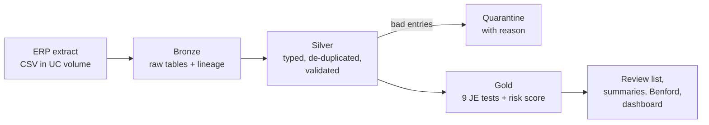

# Journal Entry Testing Pipeline on Databricks

An end-to-end **audit analytics pipeline** built on Databricks with PySpark and Delta Lake. It ingests a
general ledger extract from an ERP system, cleans and validates it through a **medallion architecture**
(Bronze → Silver → Gold), and runs **nine standard journal entry tests** that auditors use to spot
management override of controls and possible fraud (SA 240 / ISA 240).

Every journal entry gets a **risk score** and a list of reasons, so an audit team can start its review
with the riskiest entries instead of sampling at random.

## Pipeline



| Layer | Notebook | What it does |
|---|---|---|
| Setup | `_config` | Creates the `je_testing` schema and a Unity Catalog volume as the landing zone |
| Source | `01_generate_erp_extract` | Builds a realistic FY 2025-26 ledger for a fictional retailer (O2C, P2P, R2R activity) with planted red flags and data quality problems |
| Bronze | `02_bronze_ingest` | Loads the CSVs as-is (all strings) and adds `_source_file` and `_ingested_at` for traceability |
| Silver | `03_silver_clean` | Parses SAP-style `dd.MM.yyyy` dates, casts amounts to decimals, removes re-sent rows, quarantines unbalanced entries and invalid accounts, and builds line-level and entry-level tables |
| Gold | `04_gold_je_tests` | Runs the nine tests, scores every entry, and builds the review list, test summary, process summary and Benford analysis |
| Check | `05_validate_results` | Compares results with the answer key of planted issues and reports recall |

## The nine tests

| Test | What it catches | Weight |
|---|---|---|
| Weekend posting | Entries posted on Saturday or Sunday by a person | 1 |
| After-hours entry | Entries created before 7am or after 9pm by a person | 1 |
| Round amount | Totals of ₹50,000+ that are exact multiples of ₹10,000 | 1 |
| Period-end manual revenue | Manual entries crediting revenue in the last days of a quarter | 3 |
| Self-approved | Manual entries created and approved by the same user | 3 |
| Suspense or rarely used account | Postings to the suspense account or accounts used 10 times or fewer | 2 |
| Possible duplicate | Same accounts and amount posted within 7 days | 2 |
| Suspicious description | Words like *plug*, *override*, *adjustment per CFO* | 2 |
| Terminated user | Entries posted after the user's termination date | 3 |

Risk level: **High** (score 4+), **Medium** (2–3), **Low** (1).

## Results

| Step | Count |
|---|---|
| Lines in raw extract | 12,896 |
| Exact duplicate lines removed | 40 |
| Journal entries quarantined (unbalanced or invalid account) | 5 |
| Clean journal entries tested | about 5,000 |
| Entries flagged | 66 (about 1.3%) |
| High / Medium / Low risk | 3 / 39 / 24 |

- **Every planted issue was caught**: 100% recall across all nine tests and both data quality checks.
- **No normal entry was flagged.** Every extra flag was a planted entry that genuinely matched a second test too (for example, a duplicate invoice that also fell on a weekend).
- **Benford's law**: first digits of 12,846 line amounts match the expected distribution within 0.5 percentage points.

Because the data is synthetic, these numbers show the tests work as designed. Real ledgers produce more
false positives, which an auditor would review and document.

## Tables produced

| Table | Contents |
|---|---|
| `bronze_journal_entries`, `bronze_chart_of_accounts`, `bronze_users` | Raw data with lineage columns |
| `silver_journal_lines` | Clean lines with account name, type and business process |
| `silver_journal_entries` | One row per journal entry |
| `silver_quarantine` | Rejected lines with the reason |
| `silver_dq_report` | Row counts at each cleaning step |
| `gold_je_test_results` | Every entry with all nine test flags and its risk score |
| `gold_je_exceptions` | Flagged entries, highest risk first |
| `gold_test_summary`, `gold_process_summary`, `gold_benford` | Summaries for reporting |
| `gold_validation` | Recall against the answer key |

## How to run it (Databricks Free Edition)

1. Sign up for [Databricks Free Edition](https://www.databricks.com/learn/free-edition).
2. Import this repo: **Workspace → Create → Git folder**, paste the GitHub URL.
   (Or upload the files in `notebooks/` with **Workspace → Import**.)
3. Open each notebook in order (`01` → `05`), attach **Serverless** compute, and click **Run all**.
   Each notebook loads `_config` itself.
4. Optional: open **SQL Editor**, run the queries in `sql/dashboard_queries.sql`, and add them to a
   **Dashboard**.
5. Optional: create a **Job** (Jobs & Pipelines → Create → Job) with the five notebooks as tasks in
   order, so the whole pipeline runs with one click or on a schedule.

## Tech

PySpark · Delta Lake · Unity Catalog (schemas, volumes) · Databricks SQL · Python

## Project structure

```
journal-entry-testing/
├── notebooks/
│   ├── _config.py
│   ├── 01_generate_erp_extract.py
│   ├── 02_bronze_ingest.py
│   ├── 03_silver_clean.py
│   ├── 04_gold_je_tests.py
│   └── 05_validate_results.py
├── sql/
│   └── dashboard_queries.sql
└── README.md
```

The notebooks are saved in Databricks source format (`.py` with `# COMMAND ----------` cell markers), so
they open as notebooks in Databricks and read as plain Python on GitHub.
